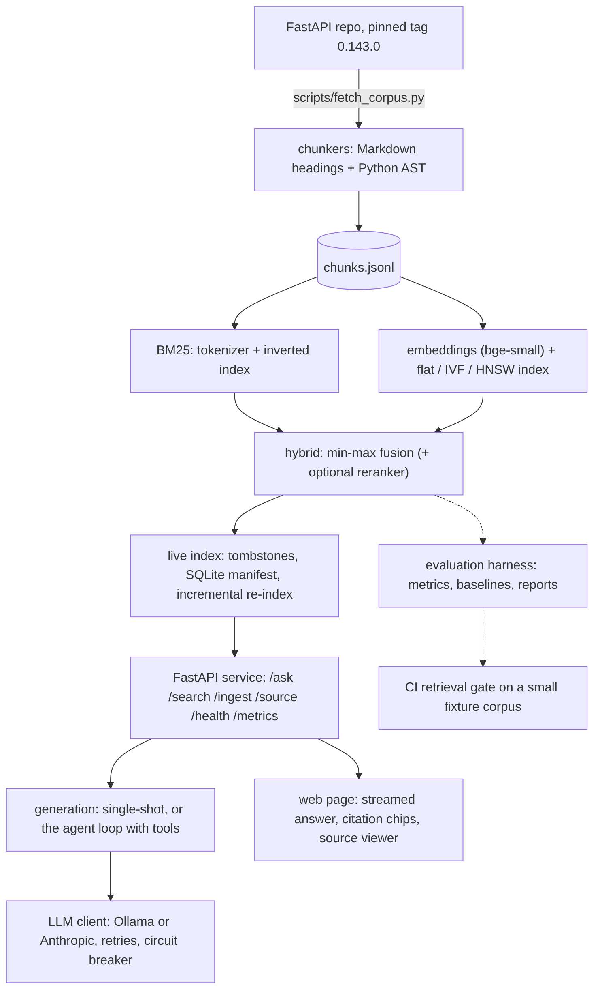

# Cairn

A from-scratch RAG engine over the [FastAPI](https://github.com/fastapi/fastapi) docs and source code (pinned to tag 0.143.0). Chunking, BM25, dense retrieval, the vector indexes (flat, IVF, HNSW), rank fusion, the reranking wrapper and the evaluation harness are written by hand: no LangChain, LlamaIndex, FAISS, Chroma or `rank_bm25`. The only library doing model work is `sentence-transformers`, which runs the embedding model and the reranking cross-encoder.

The point of the project is to understand every layer and to measure each choice, so every number below traces to a row in [`docs/results.md`](docs/results.md).

**Status: all 11 phases are done, except the last step of Phase 10: the public demo is built and tested locally but not deployed (see [Try it](#try-it)).** Retrieval, generation, an agent loop, an HTTP service with a web page, Docker and CI work and are measured (see [Roadmap](#roadmap)).

## Try it

A small page over the whole pipeline: type a question, see the answer stream in, click a citation to open the exact lines in a viewer. With no language model attached it shows the retrieved passages instead of an answer (that is also what a free public demo can do; see [`docs/deploy.md`](docs/deploy.md)).

```bash
docker compose up                      # then open http://localhost:8000 (retrieval only, 93 MiB of memory in a container)
docker compose --profile llm up        # with a local model through Ollama, http://localhost:8001
```

or without Docker: `pip install -e ".[serve,llm]"`, `python scripts/fetch_corpus.py && python scripts/ingest.py`, then `python scripts/serve.py --llm none --retriever bm25 --no-auth`. **The public demo is not deployed yet**: it needs the author's own hosting account, and everything up to that step is prepared (`scripts/make_space.py`, [`docs/deploy.md`](docs/deploy.md)).

## Results so far

40 dev questions, 3,267 chunks, k = 10. One question is worth 0.025 on a hit rate, so differences under about 0.05 are noise.

| Retriever | hit@1 | hit@5 | hit@10 | recall@10 | MRR | nDCG@10 | p50 search |
|---|---|---|---|---|---|---|---|
| Oracle (upper bound) | 1.000 | 1.000 | 1.000 | 1.000 | 1.000 | 1.000 | n/a |
| Random / first-N (floor) | 0.000 | 0.000 | 0.000 | 0.000 | 0.000 | 0.000 | n/a |
| BM25 | 0.600 | 0.750 | 0.800 | 0.750 | 0.660 | 0.658 | 2.6 ms |
| Dense (`bge-small`) | 0.600 | 0.825 | 0.925 | 0.863 | 0.711 | 0.723 | 111.7 ms |

What the measurements say:

- **Dense recalls more, but does not rank better at the top.** hit@10 goes from 0.800 to 0.925 (3 questions missed instead of 8), but hit@1 is 0.600 for both.
- **Each wins where the other loses.** Dense is far better on paraphrased questions (semantic MRR 0.432 to 0.724). BM25 is better on exact-word questions (lexical MRR 1.000 against 0.817).
- **The two fail on different questions.** At rank 1, both are right on 17 questions, only BM25 on 7, only dense on 7, neither on 9. At least one is right on 31 of 40. That is the evidence for hybrid retrieval (Phase 6).
- **Chunking mattered most.** Structure-aware chunking (Markdown headings plus a Python AST chunker) keeps 0.88 of the answers whole in 133-token chunks, against 0.78 for fixed 400-token chunks. With dense retrieval it scores MRR 0.711 against 0.43 to 0.46 for the size-based chunkers.
- **Small implementation details were worth a lot.** Splitting `snake_case` and `camelCase` identifiers lifted BM25 MRR from 0.552 to 0.660. Dropping bge's query prefix cost dense retrieval 0.106 MRR. Turning off BM25's length normalisation halves its score.
- **Dense search is about 40 times slower** than BM25 per query, and almost all of it is the model embedding the question on a CPU: the scan over the 3,267 vectors takes 0.9 ms.

- **Approximate indexes (Phase 5).** IVF and HNSW, written from scratch, are measured against the exact flat index on a **synthetic** 100,000-vector set (mixes of real chunk vectors plus noise). To reach recall 0.99, HNSW computes 560 distances per query against 100,000 for flat, and is about 3 to 5 times faster in time (the walk is a Python loop); it takes 482 s to build against 31 s for IVF. The neighbour-selection heuristic is the biggest single factor (recall 0.993 against 0.913 at the same search width). On the real 3,267-chunk corpus neither index helps: a flat scan takes 0.36 ms, so the flat index stays.

### Hybrid retrieval and reranking (Phase 6), dev and test

The 20 test questions were run once, for the whole table, after the configuration and a prediction were committed. One test question is 0.05.

| Row | dev hit@1 | dev hit@10 | dev MRR | test hit@1 | test hit@10 | test MRR | p50 |
|---|---|---|---|---|---|---|---|
| BM25 | 0.600 | 0.800 | 0.660 | 0.350 | 0.700 | 0.452 | about 5 ms |
| Dense (`bge-small`) | 0.600 | 0.925 | 0.711 | 0.550 | 0.900 | 0.659 | 20 to 44 ms |
| Hybrid, min-max fusion (**the chosen configuration**) | 0.700 | 0.925 | 0.766 | 0.350 | 0.900 | 0.533 | 23 to 50 ms |
| Hybrid RRF + cross-encoder rerank (depth 30) | 0.725 | 0.900 | 0.789 | 0.500 | 0.800 | 0.607 | about 3 s |

- **Raw scores cannot be added.** BM25's best score has a median of 30.4 and dense's 0.789, so a raw sum is BM25 with dense as a tie-breaker (MRR 0.672 against 0.660). Fusion works once each list is put on one scale (min-max) or only ranks are used (RRF).
- **On dev, fusion over dense is not shown to be real.** Min-max has MRR 0.766 against 0.711, but it is better on 9 questions and worse on 9 (95% interval of the difference: -0.046 to +0.160).
- **On test it did not hold.** Dense alone was the best row without a reranker (MRR 0.659 against 0.533 for min-max). The configuration was kept as decided before the run, because choosing dense after seeing the test split would end its use as a measurement.
- **A reranker costs about 3 s per question** (0.7 to 1.2 s at depth 10) against about 50 ms for the whole first stage. It moved the top rank and semantic questions on dev, did not raise hit@10, and lowered code questions on both splits. The cause for code is not established.
- Small-to-big expansion added 0.030 of gold-line coverage for 2.1 times the tokens.

Failures are analysed one by one in [`eval/failures/phase4.md`](eval/failures/phase4.md) (16 dense failures, classified by cause) and [`eval/failures/phase6.md`](eval/failures/phase6.md) (11 failures of hybrid + rerank).

### Generation (Phase 7), dev only

One local model (`gemma4:e4b` through Ollama, $0), hybrid retriever, k = 5, 40 answerable and 10 unanswerable dev questions, one run. The same small model also judges its answers, so read these as a first measurement, not a verdict.

- **Correctness 0.775** (31 of 40; a refusal counts as wrong), but it is **0.60 under a second judge prompt** on identical answers: the wording of the judge moved the score by 17.5 points. Faithfulness (0.763 and 0.947 under the two prompts) is not reliable: the judge disagreed with a hand grading on 4 of 15 answers.
- **Abstention:** the model refused all 10 unanswerable questions and 2 of 40 answerable ones (F1 0.909), better than any retrieval-score threshold (best F1 0.696, fitted on the same questions). The 10 unanswerable questions are about topics absent from the corpus, which is the easy case.
- **Retrieval is the cap:** with hybrid at k = 5, 6 of the 40 answerable questions had no gold chunk in the context. Dense and hybrid are a tie on that measure (0.825 against 0.850, one question).
- **Cost:** input tokens are about 25 times the output. The same 50 answers would cost about $0.35 on Opus 5.5 and $0.01 on Haiku 5.5 (estimated from token counts; no paid model was run).
- **Prompt injection:** 9 of 9 hand-written attacks held on this model. That is all it shows.

The failures are classified in [`eval/failures/phase7.md`](eval/failures/phase7.md).

### Agent loop (Phase 8), dev only

The model gets four tools (`search`, `read_chunk`, `read_file`, `list_symbols`) and a hand-written loop with hard budgets (8 steps, 30,000 tokens, 600 s) runs what it asks for. Compared with single-shot on the same questions, model, retriever and judge: one local model (`gemma4:e4b`, $0), each mode run once, so read these as a first measurement.

- **Multi-hop (10 dev questions, 15 written, 5 test never run):** correct 4 of 10 for the agent, 4 of 9 graded for single-shot. No difference at this size. The agent used **2.7 times the tokens** (about 2.6 times the estimated paid-model cost). One search on the question text finds every hop for only 1 of the 10 questions.
- **Single-hop control (40 questions):** the agent got 23 right and single-shot 29 (p = 0.24, so not shown to be a real gap), mostly on semantic questions (2 of 10 against 9 of 10).
- **What the traces showed:** 5 of 50 agent runs made no tool call at all; it never used `read_file` or `list_symbols`; it rewrote questions into queries that found less of the gold evidence (0.56 against 0.79). No tool errors, repeated calls or budget stops happened with the real model, so those mechanisms are tested only with a scripted model (300 random runs never exceed a budget).
- **Not done:** a second agent run, a better prompt, a larger model, a stronger judge. Single-shot stays the default.

The multi-hop questions were drafted with an AI assistant, and one is ambiguous. The failures are classified in [`eval/failures/phase8.md`](eval/failures/phase8.md).

### Service (Phase 9)

`python scripts/serve.py` runs a FastAPI service over the same pipeline: `POST /ask` (JSON, or server-sent events with `"stream": true`), `POST /search`, `POST /ingest` (a background re-index job), `GET /health`, `GET /metrics`. It listens at once and loads in the background (`/health` is `503` until ready), has an API key (from `CAIRN_API_KEY`), a rate limit, a concurrency limit, a circuit breaker that falls back to returning the retrieved chunks when the model is down, request ids, JSON logs and Prometheus metrics. Measured with a **fake model** on one machine, the load generator sharing it:

- **Incremental indexing:** changing 3 files of 671 re-embedded 3 of the 45 new chunks (the other 42 reused vectors) and took 0.81 s; deleted chunks become tombstones and are compacted past 25% dead slots. A tombstone does not slow search, but the dense scan still pays for dead slots (6 times the cost at 75% dead) and compaction pauses searches (42 ms here).
- **The first bottleneck** was torch using every core for one tiny query, so concurrent requests fought each other: one thread per call gave **1.5 to 1.7 times the throughput** (about 20 searches/s at 20 users instead of 12). One Python process tops out at 20 to 29 searches/s.
- **The event loop:** the same search as a blocking `async def` route made `/health` answer in 622 ms (median) at 20 users, against 5.4 ms for a plain `def` route.
- **The semantic cache is off:** on 15 paraphrases and 18 near-misses no similarity threshold separates "the same question" from "a similar one" (medians 0.93 and 0.94). The exact cache is on.
- **Not measured:** the service with a real model under load, more than one process, a real outage. See [`docs/results.md`](docs/results.md), "Phase 9", and [ADR 0008](docs/adr/0008-serving.md).

### Against LlamaIndex and FAISS (Phase 11)

The same pipeline rebuilt in LlamaIndex with FAISS, same embedding model, same questions and metric, compared with a protocol and eight predictions written before measuring ([`docs/briefs/phase11.md`](docs/briefs/phase11.md), results and explanations in [`docs/results.md`](docs/results.md), the write-up in [`docs/writeup.md`](docs/writeup.md), [ADR 0010](docs/adr/0010-framework-comparison.md)).

| row | dev hit@5 | dev MRR | test hit@5 (20 questions) | test MRR |
|---|---|---|---|---|
| Cairn dense | 0.825 | 0.711 | 0.750 | 0.659 |
| Cairn hybrid | 0.850 | 0.766 | 0.800 | 0.533 |
| LlamaIndex default | 0.525 | 0.420 | 0.650 | 0.425 |
| LlamaIndex tuned (chosen on dev from 8 candidates) | 0.775 | 0.711 | 0.650 | 0.522 |

- **On dev the default LlamaIndex pipeline was 0.30 hit@5 below Cairn dense** (95% interval +0.12 to +0.47). The cause is chunks too big for the model (46% longer than bge's 512-token window, against 3%), not split answers: every gold span sits whole inside one of its chunks. Tuned, it matched Cairn dense within one question's noise. Both sides were tuned on these dev questions.
- **On the 20 held-out questions no two rows can be told apart** (smallest p 0.25; one question is 0.05). The held-out split is now closed: it was run twice in the project. Rows tuned on dev tended to lose on test, and hybrid again did not beat dense there.
- **A trap in the documented setup:** with the FAISS L2 index LlamaIndex's docs show, its reciprocal-rank fusion silently reverses the dense ranking (MRR 0.391; 0.614 with an inner-product index).
- **FAISS HNSW was 4.2 to 5.4 times faster than Cairn's from-scratch HNSW** at the same recall (synthetic 100,000 vectors), built 21 times faster, and its exact search was slower than numpy. The framework pipeline is 18 to 28 lines against 922 for Cairn's equivalent. Three of the eight predictions were wrong.
- **Not done:** LangChain, Chroma, pgvector; a language model through the frameworks.

## How it is evaluated

- **60 questions** about FastAPI in four categories (lexical, semantic, multi-chunk, code lookup), 15 each, split into 40 dev and 20 test questions. The test split is frozen: it was run twice in the whole project (once after Phase 6, once in Phase 11) and is now closed and `run_eval.py` and `ablate_hybrid.py` refuse it without `--use-test-set`. All tuning is done on the dev questions.
- **Gold answers are file and line ranges, not chunk IDs**, so they survive any change of chunking. A retrieved chunk is a hit if its lines overlap a gold range.
- **The questions were drafted with AI assistance** from passages chosen with a helper script. Gold spans are checked by tests, and `scripts/question_overlap.py` reports how many of a question's words also appear in its answer passage, per category. Questions written after reading a passage tend to echo it somewhat, and 60 questions is a small set.
- **Metrics:** hit@k, recall@k, MRR and nDCG@k, plus latency p50 and p95. Two baselines (random, first-N) and an oracle check that the harness can tell good from bad.

## Architecture



Every retriever has the same interface (`search(query, k) -> list[Hit]`), so the harness scores any of them the same way. The hybrid retriever (fusion of BM25 and dense) and the reranking wrapper take retrievers and have the same interface, so they stack: `RerankingRetriever(HybridRetriever([bm25, dense]), scorer)`. The service uses the same retrievers over a live index that can change while it runs.

CI (`.github/workflows/ci.yml`) runs on every push and pull request: format and lint, the unit tests, the retrieval-regression gate (`scripts/ci_gate.py`: the real chunkers, BM25 and fusion on a 72-file fixture corpus with a hashing "embedding", deterministic and free, fails if hit@5 or MRR drops below `eval/ci_gate.json`), and a build of the demo Docker image that is then started and asked a question.

## Reproduce the numbers

Python 3.11 or newer. On Windows use a short-path virtual environment (the long-path limit breaks the install in deep folders).

```bash
pip install -e ".[dev,dense]"

python scripts/fetch_corpus.py        # clone FastAPI 0.143.0 into data/raw (idempotent)
python scripts/ingest.py              # chunk it into data/chunks.jsonl
python scripts/build_index.py         # BM25 index
python scripts/embed_chunks.py        # dense index (about 8 minutes on a laptop CPU the first time, then cached)

python scripts/run_eval.py --retriever bm25
python scripts/run_eval.py --retriever dense
python scripts/compare_retrievers.py  # where BM25 and dense disagree, question by question

python scripts/ablate_hybrid.py --by-category   # Phase 6 table (downloads the ~90 MB reranker model the first time)
python scripts/ablate_hybrid.py --sweep         # RRF constant and fusion weight, dev only
python scripts/ablate_hybrid.py --expansion     # small-to-big expansion
python scripts/list_failures.py --rerank --focus rrf+rerank   # where the gold passage ranks, per question
```

Tests and lint: `pytest -q` (1,773 tests, 2 skipped, no network, model or paid key needed: the dense, reranking and agent tests use small offline stand-ins and a scripted model) and `ruff check .`.

```bash
# Phase 11 (needs the framework environment: pip install llama-index-core llama-index-vector-stores-faiss llama-index-embeddings-huggingface llama-index-retrievers-bm25 faiss-cpu)
python bench/frameworks/run_all.py --all-dev          # Cairn and LlamaIndex default rows on the dev questions
python bench/frameworks/run_row.py --row li-md-code-30   # one row
python bench/frameworks/paired.py                     # paired statistics for dev and test
python bench/frameworks/faiss_vs_cairn.py             # FAISS against Cairn's indexes (data/scale-100000.npz)
python bench/frameworks/loc.py                        # lines of code, one counting rule
# the test split is closed (run twice); bench/frameworks/run_test.py --check-only will say so

# Phase 10 (the page is served by the service itself: open http://127.0.0.1:8000 after starting it)
python scripts/ci_gate.py                       # the CI retrieval gate, about 2 s, no network
python scripts/ci_gate.py --update              # print new thresholds (a deliberate, reviewed change)
python scripts/make_ci_fixture.py               # rebuild tests/fixtures/ci_corpus from data/raw/fastapi
docker build -t cairn-demo .                    # the public-demo image, BM25 only (add --build-arg WITH_DENSE=1)
python scripts/make_space.py --out ../cairn-space   # the folder to push to a Hugging Face Space

# Phase 9 (the service; --llm fake needs no model, a real model needs Ollama or an API key)
CAIRN_API_KEY=a-long-secret-of-16-or-more python scripts/serve.py --llm ollama --model gemma4:e4b
python scripts/serve.py --llm fake --no-auth --debug-blocking-route --port 8766   # for the load test
python bench/load_test.py --endpoint search --users 1 5 20 --duration 20
python bench/tombstone_cost.py
python bench/profile_retrieval.py
python scripts/semantic_cache_eval.py

# Phase 8 (needs Ollama running with gemma4:e4b; the first call loads the model)
python scripts/multihop_coverage.py                                  # is one search enough? (dev only)
python scripts/agent_eval.py --mode agent  --set multihop --llm ollama --model gemma4:e4b
python scripts/agent_eval.py --mode single --set multihop --llm ollama --model gemma4:e4b
python scripts/agent_eval.py --mode agent  --set dev      --llm ollama --model gemma4:e4b --resume
```

Both `agent_eval.py` modes accept `--llm fake` to run end to end with no model. The Phase 8 paired statistics come from a one-off script that is not in the repository; `docs/results.md` says so.

The ablation scripts behind the tables in `docs/results.md` are `scripts/compare_chunkers.py`, `scripts/ablate_bm25.py`, `scripts/ablate_dense.py`, `scripts/bench_search.py`, `scripts/bench_embed.py`, `scripts/eval_ann.py` and `scripts/ablate_hybrid.py`. A few Phase 6 numbers (rerank depth, the time breakdown, truncation, the paired statistics) come from one-off scripts that are not in the repository; `docs/results.md` says which.

## Repository layout

```
src/cairn/
  ingest/       documents, chunkers, pipeline
  retrieval/    tokenizer, inverted index, BM25, fusion, hybrid retriever, reranker, context expander
  dense/        embedder, embedding cache, flat index, dense retriever, model registry
  ann/          k-means, IVF and HNSW indexes
  evaluation/   metrics, questions, baselines, harness, chunk-integrity metric, generation and agent evaluation
  generation/   LLM clients (Anthropic, Ollama) with retries, context packer, prompts, citations, abstention
  agent/        tool registry and the four corpus tools, the loop, budgets, traces
  serve/        the HTTP service: API, live index, incremental indexing, caches, limits, metrics,
                the web page (serve/static) and the source viewer
scripts/        one runnable script per task (ingest, build_index, embed_chunks, run_eval, serve, ci_gate, ablations)
bench/          load test, tombstone cost, retrieval profile, ANN benchmarks, frameworks/ (the LlamaIndex and FAISS comparison, its results and the freeze)
eval/           questions.jsonl (data only), ci_gate.json (the CI thresholds) and failures/ (failure analyses)
tests/          unit and script tests; fixtures/ci_corpus is a copy of 72 FastAPI files for the CI gate
.github/        the CI workflow
Dockerfile, docker-compose.yml   the image (data baked in at build) and the local stack
docs/           results.md (every number), adr/ (decisions), notes/ (what I learned per phase), briefs/
PLAN.md         the full 11-phase plan and its status
```

Decisions are recorded as short ADRs: [chunking](docs/adr/0001-chunking.md), [BM25 settings](docs/adr/0002-bm25-settings.md), [dense retrieval](docs/adr/0003-dense-retrieval.md), [approximate indexes](docs/adr/0004-ann-indexes.md), [hybrid retrieval](docs/adr/0005-hybrid-retrieval.md), [generation](docs/adr/0006-generation.md), [the agent loop](docs/adr/0007-agent-loop.md), [the service](docs/adr/0008-serving.md), [shipping](docs/adr/0009-shipping.md), [the framework comparison](docs/adr/0010-framework-comparison.md).

## Roadmap

| Phase | Topic | Status |
|---|---|---|
| 0 | Foundations: package, config, pinned corpus fetch | done |
| 1 | The yardstick: 60 questions, metrics, harness, baselines | done |
| 2 | Ingestion and chunking (4 chunkers, gold-integrity metric) | done |
| 3 | BM25 from scratch | done |
| 4 | Dense retrieval: embedder, cache, flat index | done |
| 5 | Approximate nearest-neighbour indexes (k-means, IVF, HNSW) from scratch | done |
| 6 | Hybrid retrieval (rank fusion), cross-encoder reranking, small-to-big expansion; first run of the test split | done |
| 7 | Generation with citations and abstention, LLM client, generation eval | done |
| 8 | Agent loop with tools, measured against single-shot | done |
| 9 | FastAPI service: streaming, incremental indexing, caching, rate limiting, load test | done |
| 10 | Frontend, Docker, CI with a retrieval-regression gate, deployment | done, except that the public demo is not deployed |
| 11 | Benchmark against LlamaIndex and FAISS; the final test run; write-up | done |

The details of each phase are in [`PLAN.md`](PLAN.md).

## How it was built

This is a learning project built with an AI assistant (Claude) as tutor and pair: it wrote the phase briefs and the tests that each phase has to pass, helped with the implementation, and reviewed the code. The evaluation questions were drafted the same way (see above). The experiments, the measurements and the failure analyses are run on the real corpus, and the notes in `docs/notes/` record what each phase taught.

In Phase 11 the comparison code, the protocol, the statistics and the write-ups were also written by the assistant at the author's request; the eight predictions in the brief were the assistant's, and three of them were wrong. In Phase 10 the web page, the Docker and CI files, the retrieval gate and the deployment preparation were also written by the assistant at the author's request, with tests. In Phase 9 the implementation of the service (`src/cairn/serve/`, the load test, the benchmarks, the semantic-cache pairs) was also written by the assistant at the author's request, with its tests. In Phase 8 the implementation (the clients' tool support, the agent modules, the evaluation script) and the 15 multi-hop questions were written by the assistant at the author's request, with tests written first and checked against a reference solution and deliberately broken variants of it. The earlier phases were written by the author with the assistant as tutor.

The Anthropic client (Phase 7) reads its key from the `ANTHROPIC_API_KEY` environment variable and the key is never in the code. All Phase 7, 8 and 9 numbers come from a local model or a fake one, so no key was used. The service takes its own API key only from `CAIRN_API_KEY`, never from the command line.
