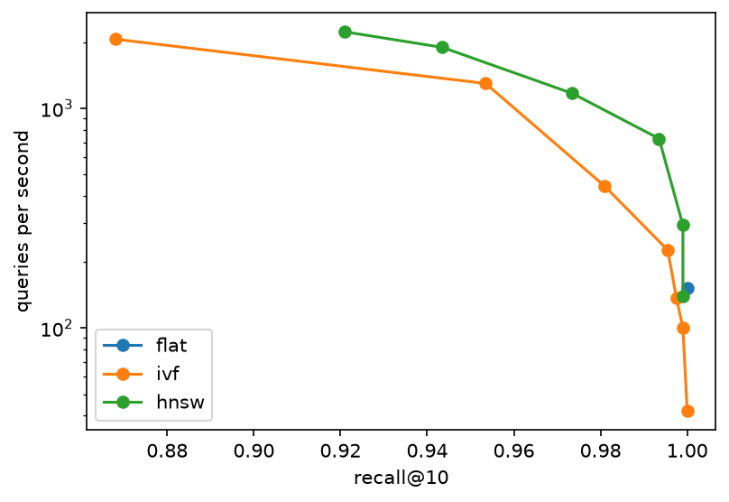

# Results

Lab notebook. Every number in the README must trace back to a row here.

## Corpus (FastAPI 0.143.0)

| Part | Location | Files |
|---|---|---|
| Markdown docs | docs/en/docs | 156 |
| Python source | fastapi/ | 52 |

## Baselines on the dev questions

40 dev questions, k = 10. Date: 2026-10-13. Commit: 2e69929.

Candidates are 40-line windows of **every** `.md` and `.py` file under `data/raw/fastapi`: 10,608 windows. That is a bigger and noisier pool than the corpus I actually mean (`docs/en/docs`, `fastapi/` and `docs_src/`): it also contains the translated docs (for example `docs/de/...`) and the repository's own `tests/` folder. Narrowing the corpus is a decision for Phase 2.

| Retriever | hit@1 | hit@5 | hit@10 | recall@1 | recall@10 | MRR | nDCG@10 |
|---|---|---|---|---|---|---|---|
| oracle | 1.000 | 1.000 | 1.000 | 0.875 | 1.000 | 1.000 | 1.000 |
| first-N | 0.000 | 0.000 | 0.000 | 0.000 | 0.000 | 0.000 | 0.000 |
| random, seed 0 | 0.000 | 0.000 | 0.000 | 0.000 | 0.000 | 0.000 | 0.000 |
| random, seed 1 | 0.000 | 0.000 | 0.000 | 0.000 | 0.000 | 0.000 | 0.000 |
| random, seed 2 | 0.000 | 0.000 | 0.000 | 0.000 | 0.000 | 0.000 | 0.000 |

Oracle, `multi_chunk` questions only: recall@1 = 0.500 (all other categories: 1.000).

Commands: `python scripts/run_eval.py --retriever oracle` (and `first`, `random --seed N`).
The test split was not used.

### What this shows

1. If the oracle returned anything other than 1.000, I would suspect a bug in the loader, the metrics or the harness. It returns exactly the gold spans, so it must score perfectly. It does, so the three agree with each other.
2. Random and first-N both score about 0, so the questions cannot be answered by luck or by position. Random picks 10 windows out of 10,608, which is roughly a 0.1-0.3% chance per question, so guessing does not work. First-N returns the same windows for every question (the alphabetically first files, a German translation page `docs/de/docs/_llm-test.md`), so it measures what you get from ignoring the question completely: nothing.
3. The oracle's recall@1 is 0.875, not 1.0, on purpose. The 10 `multi_chunk` questions each have **two** gold spans, and at k = 1 only one result fits, so recall@1 is 1/2 = 0.500 for them. The other 30 questions have one gold span, so they score 1.0: (30 x 1.0 + 10 x 0.5) / 40 = 0.875.

## Phase 2: chunking strategies on the dev questions

40 dev questions. Date: 2026-10-20. Commit: 7598ace. Command: `python scripts/compare_chunkers.py`.

Corpus: 671 documents (155 prose, 516 code): `docs/en/docs/**/*.md` without `release-notes.md`, plus `fastapi/**/*.py` and `docs_src/**/*.py`. Translations and the repository's own `tests/` are excluded.

"intact" is the share of gold spans that fit completely inside one chunk. It is an upper bound on retrieval quality: a retriever cannot return a whole answer that no single chunk contains.

| Strategy | Chunks | Mean tokens | >512 | Intact | lexical | semantic | multi_chunk | code |
|---|---|---|---|---|---|---|---|---|
| fixed-100 | 5112 | 85.3 | 1 | 0.120 | 0.100 | 0.100 | 0.200 | 0.000 |
| fixed-200 | 2576 | 169.2 | 1 | 0.460 | 0.600 | 0.400 | 0.550 | 0.200 |
| fixed-400 | 1477 | 295.1 | 1 | 0.780 | 0.900 | 0.500 | 0.900 | 0.700 |
| recursive-200 | 2767 | 157.5 | 1 | 0.620 | 0.700 | 0.400 | 0.700 | 0.600 |
| recursive-400 | 1561 | 279.2 | 1 | 0.800 | 0.800 | 0.500 | 0.950 | 0.800 |
| recursive-200 + overlap 3 | 2767 | 185.6 | 1 | 0.680 | 0.800 | 0.400 | 0.750 | 0.700 |
| structure-150 | 3962 | 110.0 | 76 | 0.660 | 0.800 | 0.300 | 0.750 | 0.700 |
| **structure-300** | 3267 | 133.4 | 76 | 0.880 | 0.900 | 0.900 | 0.950 | 0.700 |
| structure-600 | 3087 | 141.2 | 105 | 0.920 | 0.900 | 1.000 | 1.000 | 0.700 |

"structure-N" is the heading-aware Markdown chunker (budget N tokens) for docs plus the AST Python chunker for code. For code, N only sets the fallback used when a file does not parse, which is why the code column does not move.

The test split was not used.

### Ingest statistics for structure-300

Command: `python scripts/ingest.py`. 671 documents, 3,267 chunks (1,392 prose, 1,875 code), mean 133.4 tokens, max 7,124, 76 chunks over 512 tokens.

| Tokens | <=50 | 51-100 | 101-200 | 201-300 | 301-400 | 401-512 | >512 |
|---|---|---|---|---|---|---|---|
| Chunks | 1226 | 770 | 685 | 468 | 31 | 11 | 76 |

### What this shows

1. **Structure-aware chunking wins at a smaller size.** structure-300 keeps 0.88 of the gold spans intact with chunks of 133 tokens on average. fixed-400 keeps 0.78 with chunks of 295 tokens, more than twice as large. Cutting at headings and function boundaries keeps answers together without needing big chunks. The semantic questions show it best: 0.40-0.50 for every size-based strategy, 0.90 for structure-300.
2. **Bigger is better for this metric, but the metric cannot see the cost.** Fixed chunking goes from 0.12 to 0.46 to 0.78 as the size doubles. A chunk containing the whole file would score 1.0 and be useless for search, so the table also lists chunk size.
3. **The biggest chunk is `FastAPI.__init__`**: `fastapi/applications.py` lines 64-1052, 7,124 tokens. The AST chunker makes one function one chunk, and this signature has about 60 parameters, each documented inline with a long `Doc("...")` string. The next largest are 2,800-3,400 tokens: `get_request_handler` in `routing.py`, then `APIRouter.put/post/head/patch/trace` and `FastAPI.put`, all with the same huge parameter documentation.
4. **All 76 chunks over 512 tokens are code; none is prose.** They cluster in `routing.py` (21), `applications.py` (13), `param_functions.py` (9), `params.py` (8) and `dependencies/utils.py` (6). Prose never goes over because the Markdown chunker splits an oversized section by paragraph; the Python chunker never splits a function. An embedding model with a 512-token limit would truncate these chunks.
5. **Six dev spans are cut by structure-300** (`--show-broken structure-300`), for three different reasons:

| Question | Gold span | Why it is cut |
|---|---|---|
| q034 (code) | `fastapi/datastructures.py` 153-168, a whole class | split into a header chunk plus one chunk per method |
| q043 (code) | `docs_src/handling_errors/tutorial004_py310.py` 1-26, a whole example file | split into imports plus one chunk per function |
| q044 (code) | `docs_src/dependencies/tutorial005_py310.py` 1-20, a whole example file | same |
| q023 (semantic) | `dependencies-with-yield.md` 187-200 | the section is about 333 tokens, over the 300 budget, so it was split by paragraph into 187-195 and 197-200 |
| q049 (multi_chunk) | `dependencies-with-yield.md` 268-288 | its section is also over budget and is split at line 283, inside the gold span |
| q005 (lexical) | `http-basic-auth.md` 95-102 | the chunk is 95-101: line 102 of the gold span is a blank line, and every chunker trims blank edge lines |

   The code failures are **structural**: the questions ask for a whole class or a whole example file, and the AST chunker splits at exactly those boundaries. No size setting changes that, which is why code stays at 0.70 for structure-150, -300 and -600. q023 and q049 are budget cuts: structure-600 fixes them (semantic 1.000). q005 is an **annotation flaw**, not a chunker flaw: the gold span ends on a blank line. It stays broken at every size (lexical stays at 0.900 for structure-300 and -600). I have not edited the gold span, because changing the answer key after seeing a result has to be a deliberate, documented change.
6. **Choice for the rest of the project: structure-300.** It has the best balance: 0.88 intact, small chunks, and fewer oversized chunks than structure-600 (76 against 105). structure-600 gains only 0.04, entirely from the two over-budget prose sections, and puts 29 more chunks past the 512-token limit.

Open problems for later: 76 code chunks over 512 tokens, and whole-class or whole-file answers that the AST chunker splits (code intact 0.70).

Commands: `python scripts/ingest.py`; `python scripts/compare_chunkers.py`; `python scripts/compare_chunkers.py --show-broken structure-300`.

## Phase 3: BM25 baseline

40 dev questions, k = 10. Date: 2026-10-21. Commit: ca9c4f4.

Setup: `structure-300` chunks (the Phase 2 choice, 3,267 chunks), the code-aware tokenizer (identifiers kept whole and also split into their parts, no stopwords), `k1 = 1.2`, `b = 0.75`. The index has 7,184 distinct terms, a mean chunk length of 86.9 tokens, and is a 1.1 MB pickle file (`chunks.jsonl` is 2.7 MB).

| Retriever | hit@1 | hit@5 | hit@10 | recall@1 | recall@10 | MRR | nDCG@10 |
|---|---|---|---|---|---|---|---|
| oracle (Phase 1) | 1.000 | 1.000 | 1.000 | 0.875 | 1.000 | 1.000 | 1.000 |
| random / first-N (Phase 1) | 0.000 | 0.000 | 0.000 | 0.000 | 0.000 | 0.000 | 0.000 |
| **BM25** | 0.600 | 0.750 | 0.800 | 0.525 | 0.750 | 0.660 | 0.658 |

By question category:

| Category | n | hit@1 | hit@10 | recall@10 | MRR | nDCG@10 |
|---|---|---|---|---|---|---|
| lexical | 10 | 1.000 | 1.000 | 1.000 | 1.000 | 1.000 |
| semantic | 10 | 0.300 | 0.800 | 0.800 | 0.432 | 0.518 |
| multi_chunk | 10 | 0.600 | 0.800 | 0.600 | 0.658 | 0.551 |
| code | 10 | 0.500 | 0.600 | 0.600 | 0.550 | 0.563 |

Search time over 800 searches (the 40 dev questions, 20 times each): p50 2.62 ms, p95 4.13 ms, max 8.39 ms. The target was p95 under 20 ms.

Commands: `python scripts/ingest.py`, `python scripts/build_index.py`, `python scripts/run_eval.py --retriever bm25`, `python scripts/bench_search.py`. The test split was not used.

### What this shows

1. **BM25 is perfect on exact-word questions and weakest on meaning.** All 10 lexical questions have the answer at rank 1 (MRR 1.000). The semantic questions need rank 10 to get 0.800 but only 0.300 at rank 1. A keyword engine finds the answer when the question uses the passage's own words, and struggles when the question paraphrases it.
2. **It is far above the floor and well below the ceiling.** Random and first-N score 0.000, the oracle 1.000. BM25 gets MRR 0.660, so it already works, and 8 of 40 questions are still missed at k = 10.
3. **It is fast.** p95 of 4.1 ms is about five times under the 20 ms target, from a plain dictionary of lists and a heap, with no model and no special hardware.

### The 8 misses (no gold passage in the top 10)

For each, where the first chunk that overlaps the gold span ranked, out of all chunks that share at least one word with the question.

| Question | Category | Gold rank | Why BM25 missed it |
|---|---|---|---|
| q017 spellings accepted as "true" | semantic | 212 | **Vocabulary mismatch.** The passage contains `true` but none of the content words of the question (`spellings`, `accepted`, `boolean`, `option`, `url`). |
| q026 turn off the interactive docs in production | semantic | 1217 | **Vocabulary mismatch.** The gold chunk shares only `can` and `the` with the question: it talks about disabling the OpenAPI URLs, the question says "turn off the interactive documentation pages". |
| q031 status codes with no body | code | 188 | **Docs outrank code, and there is no stemming.** The tutorial page about status codes is dense in the question's words and scores 36; the function `is_body_allowed_for_status_code` has `code` but the question says `codes`. |
| q041 yield dependency into an async context manager | code | 136 | **Docs outrank code.** "How does the code ..." is a question about the implementation, but the docs pages on `yield` contain the same words more often. BM25 cannot tell that the user wants source code. |
| q043 what the HTTPException handler returns in the example | code | 16 | **The answer is split across chunks.** The gold span is a whole example file, which `structure-300` cuts into 4 chunks (41, 46, 86 and 73 tokens); the docs page about error handling matches the words better than any one small chunk. This is the Phase 2 finding again. |
| q044 one dependency uses another: what is returned with no query | code | 972 | **Vocabulary mismatch plus a split file.** The 4 chunks of the file share only `query` with the question (the code says `query_extractor`, `read_query`). |
| q058 why filter data through the response model; what if validation fails | multi_chunk | 20 | **Many chunks compete.** The question is long and generic, and several chunks of the response-model page share its words. The two specific gold chunks rank 20th and lower, and each lacks some of the question's content words (`serialization`, `fails`, `happens`). |
| q059 declare routes in a separate module and attach them to the main app | multi_chunk | 47 | **Vocabulary mismatch.** The passages talk about `APIRouter` and `include_router`; the question says `attach`, `separate` and `module`. |

Five kinds of failure: vocabulary mismatch (q017, q026, q044, q059), docs ranked above the code the user asked about (q031, q041), no stemming (`codes` against `code`, q031), answers cut across chunks (q043, q044), and a long generic question with many competing chunks (q058). Embeddings (Phase 4) should help with the first, hybrid retrieval and reranking (Phase 6) with the second, a stemmer is a cheap tokenizer experiment, and parent-child retrieval is the idea for the fourth.

### Experiments: tokenizer variants x chunkers

Dev questions only, k = 10, `k1 = 1.2`, `b = 0.75`. Date: 2026-10-22. Command: `python scripts/ablate_bm25.py --by-category`. `plain` = identifiers kept whole only; `split` = whole and parts; `+stop` = the English stopword list removed.

| Chunker | Tokenizer | Terms | hit@1 | hit@10 | MRR | nDCG@10 | MRR lexical | MRR semantic | MRR multi_chunk | MRR code |
|---|---|---|---|---|---|---|---|---|---|---|
| fixed-200 | plain | 6606 | 0.375 | 0.675 | 0.459 | 0.464 | 0.683 | 0.355 | 0.472 | 0.325 |
| fixed-200 | split | 7184 | 0.425 | 0.725 | 0.514 | 0.512 | 0.750 | 0.355 | 0.625 | 0.325 |
| fixed-200 | plain+stop | 6573 | 0.400 | 0.700 | 0.478 | 0.505 | 0.650 | 0.454 | 0.464 | 0.344 |
| fixed-200 | split+stop | 7151 | 0.450 | 0.700 | 0.523 | 0.523 | 0.614 | 0.433 | 0.668 | 0.377 |
| fixed-400 | plain | 6606 | 0.400 | 0.800 | 0.502 | 0.529 | 0.633 | 0.437 | 0.674 | 0.267 |
| fixed-400 | split | 7184 | 0.525 | 0.850 | 0.597 | 0.611 | 0.850 | 0.415 | 0.702 | 0.421 |
| fixed-400 | plain+stop | 6573 | 0.450 | 0.725 | 0.524 | 0.544 | 0.675 | 0.428 | 0.661 | 0.333 |
| fixed-400 | split+stop | 7151 | 0.500 | 0.775 | 0.564 | 0.581 | 0.760 | 0.407 | 0.662 | 0.429 |
| recursive-400 | plain | 6606 | 0.375 | 0.725 | 0.467 | 0.492 | 0.639 | 0.382 | 0.632 | 0.217 |
| recursive-400 | split | 7184 | 0.475 | 0.750 | 0.562 | 0.567 | 0.850 | 0.370 | 0.700 | 0.327 |
| recursive-400 | plain+stop | 6573 | 0.425 | 0.725 | 0.495 | 0.506 | 0.675 | 0.418 | 0.648 | 0.239 |
| recursive-400 | split+stop | 7151 | 0.475 | 0.750 | 0.544 | 0.559 | 0.750 | 0.398 | 0.681 | 0.347 |
| structure-300 | plain | 6606 | 0.450 | 0.750 | 0.552 | 0.564 | 0.820 | 0.439 | 0.614 | 0.334 |
| **structure-300** | **split** | 7184 | **0.600** | 0.800 | **0.660** | 0.658 | **1.000** | 0.432 | 0.658 | 0.550 |
| structure-300 | plain+stop | 6573 | 0.450 | 0.725 | 0.549 | 0.561 | 0.750 | 0.433 | 0.667 | 0.348 |
| structure-300 | split+stop | 7151 | 0.575 | 0.825 | 0.654 | 0.663 | 0.833 | 0.448 | 0.725 | 0.611 |

With 40 questions, moving one question from rank 1 to not found changes hit@1 by 0.025, so a difference of one or two questions is not evidence.

### Experiments: k1 x b

Command: `python scripts/ablate_bm25.py --tune structure-300 --tokenizer split`. MRR on the dev questions.

| | b=0 | b=0.25 | b=0.5 | b=0.75 | b=1 |
|---|---|---|---|---|---|
| k1=0 | 0.314 | 0.314 | 0.314 | 0.314 | 0.314 |
| k1=0.6 | 0.331 | 0.577 | 0.628 | 0.633 | 0.638 |
| k1=0.9 | 0.329 | 0.604 | 0.644 | 0.654 | 0.637 |
| k1=1.2 | 0.320 | 0.603 | 0.649 | **0.660** | 0.619 |
| k1=1.5 | 0.280 | 0.592 | 0.642 | 0.651 | 0.558 |
| k1=2 | 0.280 | 0.590 | 0.633 | 0.633 | 0.518 |
| k1=3 | 0.242 | 0.586 | 0.611 | 0.584 | 0.465 |

### What the experiments show

1. **Splitting identifiers helps, and the direction is the same for all four chunkers.** MRR goes from 0.459 to 0.514 (fixed-200), 0.502 to 0.597 (fixed-400), 0.467 to 0.562 (recursive-400) and 0.552 to 0.660 (structure-300). For structure-300, hit@1 rises from 0.450 to 0.600, which is 6 questions. Per category (structure-300), lexical goes from 0.820 to 1.000 and code from 0.334 to 0.550, while semantic is flat (0.439 to 0.432). Comparing the two rankings question by question: splitting is better on 15 questions, worse on 7 and the same on 18 (counted with a throwaway script, not committed). Most of the 7 are small moves (for example rank 2 to 3, or 4 to 7). It helps because the passages and code contain identifiers and the questions use plain words: for q032, "How is the default unique operation ID of a route assembled?", the gold chunk contains the identifiers `generate_unique_id` and `operation_id`. With the plain tokenizer only `route` matches (gold at rank 226); with splitting `id`, `operation`, `route` and `unique` all match (rank 2). It does not help semantic questions, which fail for a different reason: the passage uses other words.
2. **Stopwords are noise here.** For structure-300 + split they change MRR from 0.660 to 0.654 and hit@10 from 0.800 to 0.825 (one question); lexical drops from 1.000 to 0.833 while code rises from 0.550 to 0.611. For the other chunkers the effect has no consistent sign: +0.019 and +0.022 and +0.028 without splitting, but 0.597 to 0.564 (fixed-400) and 0.562 to 0.544 (recursive-400) with it. Differences of 0.01 to 0.04 are one or two questions. BM25's idf already gives common words almost no weight, so removing them changes little. No stopwords is the simpler choice and is not worse.
3. **The chunker matters, and the ranking agrees with Phase 2 on the low end.** With splitting, structure-300 has the best MRR (0.660), then fixed-400 (0.597), recursive-400 (0.562) and fixed-200 (0.514), the same worst chunker as in the Phase 2 integrity table (0.46). The orders do not match exactly: fixed-400 has the best hit@10 (0.850 against 0.800) although only 0.78 of its answers are intact. Bigger chunks contain more of the question's words, so they are found within 10 results more often but rank lower, and hit@10 gives credit for any overlap with the answer, even when the answer is cut across chunks.
4. **The defaults are about the best.** The best cell of the grid is `k1 = 1.2, b = 0.75` (0.660). Nearby cells are within 0.02 (`k1 = 0.9`: 0.654, `k1 = 1.5`: 0.651), which is noise on 40 questions, so the defaults stay. Two cells are very informative: `b = 0` gives about 0.32 for every `k1`, half the score, because without length normalisation the chunks that are very long (the 76 code chunks over 512 tokens, up to 7,124) collect matches from many words and outrank the focused chunks. `k1 = 0`, where only the presence of a word counts and not how often it occurs, gives 0.314 for every `b`: term frequency is worth about 0.35 of MRR. `b = 1` hurts at large `k1` (0.465 at `k1 = 3`) because it penalises long chunks too much, and some correct chunks are long.
5. **Keyword baseline for Phases 4-6: `structure-300` chunks, the `split` tokenizer, no stopwords, `k1 = 1.2`, `b = 0.75`.** MRR 0.660, hit@10 0.800, p95 search time 4 ms.

## Phase 4: dense retrieval

Same 3,267 `structure-300` chunks and the same 40 dev questions as Phase 3. Each chunk (its heading plus text) is embedded once with `bge-small` (384 dimensions) and a question is matched to chunks by dot product of unit vectors (cosine). The index is a flat matrix searched by brute force.

| Retriever | hit@1 | hit@5 | hit@10 | recall@10 | MRR | nDCG@10 | p50 search |
|---|---|---|---|---|---|---|---|
| BM25 (Phase 3) | 0.600 | 0.750 | 0.800 | 0.750 | 0.660 | 0.658 | 2.6 ms |
| **Dense, bge-small** | 0.600 | 0.825 | 0.925 | 0.863 | 0.711 | 0.723 | 111.7 ms |
| Dense, bge-small, no query prefix | 0.450 | 0.800 | 0.825 | 0.762 | 0.605 | 0.634 | 134.8 ms |
| Dense, minilm | 0.350 | n/a | 0.800 | n/a | 0.492 | 0.529 | n/a |

By question category (MRR, with hit@10 in brackets):

| Category | n | BM25 | Dense bge-small |
|---|---|---|---|
| lexical | 10 | 1.000 (1.000) | 0.817 (1.000) |
| semantic | 10 | 0.432 (0.800) | 0.724 (0.900) |
| multi_chunk | 10 | 0.658 (0.800) | 0.700 (0.900) |
| code | 10 | 0.550 (0.600) | 0.602 (0.900) |

Commands: `python scripts/embed_chunks.py`, `python scripts/run_eval.py --retriever dense` (also with `--no-query-prefix`), `python scripts/ablate_dense.py --by-category`, `python scripts/bench_embed.py --model bge-small`. The test split was not used. One question is 0.025 of a hit rate, so differences below about 0.05 are noise.

### What this shows

1. **Dense finds the answer more often than BM25.** hit@10 goes from 0.800 to 0.925 and recall@10 from 0.750 to 0.863: 3 questions are missed instead of 8. The largest gain is on `code` (hit@10 0.600 to 0.900).
2. **Dense wins on meaning and loses on exact words.** Semantic MRR goes from 0.432 to 0.724 (hit@1 from 0.300 to 0.700). Lexical MRR falls from 1.000 to 0.817: every lexical answer is still in the top 10, but only 7 of the 10 are at rank 1. The other three are at rank 2 or 3 (q004, q005, q007), and for two of them (q005, q007) the top result is another chunk of the right page.
3. **hit@1 is the same (0.600).** The gain is in recall within the top 10, not in putting the answer first, so "dense ranks better" is not supported by this data, "dense recalls more" is.
4. **The two retrievers fail on different questions.** At rank 1: both are right on 17, only BM25 on 7, only dense on 7, neither on 9. At least one is right on 31 of 40 (0.775), against 0.600 for each alone. This is the case for hybrid retrieval in Phase 6.
5. **The query prefix is worth a lot, on this setup.** Without bge's "Represent this sentence for searching relevant passages: " prefix, MRR falls from 0.711 to 0.605, hit@10 from 0.925 to 0.825, and 4 more questions are missed (q016, q026, q031, q034). Every category is lower. It is not a general law: with the three other chunkers the prefix changes MRR by at most 0.012 in either direction (see below), so the gain is large only for `structure-300`. I did not find out why.
6. **The model matters.** `minilm` (384 dimensions too, no prefix) reaches MRR 0.492 against 0.711 for `bge-small`, and its lexical MRR is only 0.526. The bigger gain comes from the model, not from the chunker or the settings.
7. **It costs a lot more than BM25.** A search takes 112 ms (p50) against 2.6 ms, about 40 times. The brute-force scan over the 3,267 vectors takes 0.9 ms; embedding a question alone takes 38.5 ms (30 repeated runs of one question, measured separately), so the model is almost all of it. The eval's p50 of 112 ms is higher than the 38.5 ms and I did not find out why. Building the index took 471 s for the 2,802 distinct chunk texts (465 chunks are exact duplicates of another chunk, mostly repeated tutorial code, and were taken from the cache). A second run takes 0.0 s. The index itself is small: 3,267 x 384 x 4 bytes = 5.0 MB, which scales to 154 MB per 100,000 chunks.
8. **83 chunks are over the model's 512-token limit** and are truncated: the model never sees their tail. (BM25 had 76 over the same limit with a different tokenizer, and the two counts are not comparable.)

### Experiments: chunkers (bge-small)

| Chunker | Chunks | Prefix | hit@1 | hit@10 | MRR | nDCG@10 | MRR lexical | MRR semantic | MRR multi_chunk | MRR code |
|---|---|---|---|---|---|---|---|---|---|---|
| fixed-200 | 2,576 | on | 0.325 | 0.675 | 0.431 | 0.453 | 0.408 | 0.472 | 0.544 | 0.298 |
| fixed-200 | 2,576 | off | 0.325 | 0.700 | 0.443 | 0.470 | 0.408 | 0.485 | 0.517 | 0.363 |
| fixed-400 | 1,477 | on | 0.250 | 0.750 | 0.448 | 0.496 | 0.400 | 0.550 | 0.562 | 0.281 |
| fixed-400 | 1,477 | off | 0.250 | 0.775 | 0.440 | 0.494 | 0.375 | 0.536 | 0.552 | 0.298 |
| recursive-400 | 1,561 | on | 0.300 | 0.750 | 0.457 | 0.501 | 0.408 | 0.544 | 0.583 | 0.292 |
| recursive-400 | 1,561 | off | 0.300 | 0.750 | 0.450 | 0.492 | 0.408 | 0.509 | 0.588 | 0.295 |
| **structure-300** | 3,267 | on | **0.600** | **0.925** | **0.711** | **0.723** | 0.817 | 0.724 | 0.700 | 0.602 |
| structure-300 | 3,267 | off | 0.450 | 0.825 | 0.605 | 0.634 | 0.767 | 0.600 | 0.533 | 0.520 |

1. **The chunker matters more than anything else tried.** `structure-300` has MRR 0.711 against 0.431 to 0.457 for the three size-based chunkers, and hit@1 0.600 against 0.250 to 0.325. It does this with the most chunks (3,267), so there are more places to go wrong, not fewer. The order of the chunkers agrees with BM25 in Phase 3 (structure-300 first) and with the integrity table of Phase 2.
2. **Dense hardly helps the size-based chunkers' ranking.** For `fixed-400` and `recursive-400` the dense MRR (0.448, 0.457) is below their BM25 MRR with the split tokenizer (0.597, 0.562). Only for `structure-300` is dense above BM25 (0.711 against 0.660). I did not investigate why.
3. **Do not read the prefix on/off differences of the size-based chunkers.** They are at most 0.012 MRR and change sign from row to row, which is one or two questions.

Dense retrieval baseline for Phases 5-6: `structure-300` chunks, `bge-small`, trained query prefix, flat index. MRR 0.711, hit@10 0.925, p50 search time 112 ms.

### Embedding speed

Sorting the chunks by length before batching makes the model faster (padding is wasted work): on a sample of 160 chunks, 5.4 chunks/s in the original order (batch 32) against 8.9 chunks/s sorted (batch 16), 1.65 times faster, and batch 16 was better than 8 or 32. The real run (5.9 chunks/s) was slower than the benchmark predicted (about 366 s for the corpus, 471 s measured); I did not find out why.

## Phase 5: approximate nearest-neighbour indexes

Two indexes written from scratch with numpy (no `faiss`, `scikit-learn`, `hnswlib`): **IVF** (spherical k-means with k-means++ starts, then search only the `nprobe` closest of `nlist` lists) and **HNSW** (a layered graph of neighbour links, searched with a beam). Both are measured against the flat index of Phase 4, which is the exact answer.

**The 100,000-vector set is synthetic.** The corpus has only 3,267 chunks, where no index can beat a flat scan, so `scripts/make_scale_set.py` makes 100,000 vectors, each a mix of two real chunk vectors plus noise, scaled to length 1 (queries are made the same way, 200 of them are used). It has the shape of real embeddings (384 numbers, unit length) but it is not real text, and its clusters may be easier or harder than the real ones: the real-corpus section below shows IVF doing much worse there. Everything marked "scale set" is this data, everything marked "real" is the 3,267 real chunk vectors with the 40 dev questions. The test split was not used.

Measures: **recall@10** is the share of the flat index's exact top 10 that the index also returned. **Distances** is the number of dot products computed per query (for IVF, the `nlist` centre scores plus every vector scanned): it does not depend on the machine. **Queries/s** does, and it is noisy: the same flat index measured 141 to 175 queries/s in different runs, and one IVF setting (`nprobe = 2`) 1,297 and 1,616, so only differences of about 2 times or more mean anything. Recall is from 200 queries x 10 neighbours, so 0.001 is 2 neighbours and differences of about 0.005 are noise. Every graph is built once with seed 0.

### Recall against speed on the scale set (100,000 vectors)

Flat: recall 1.000, 100,000 distances, 141 to 175 queries/s, vectors 153.6 MB.

| Index | recall@10 | distances | queries/s |
|---|---|---|---|
| IVF `nlist` 316, `nprobe` 1 | 0.868 | 760 | 2,065 to 4,179 |
| IVF 316, `nprobe` 2 | 0.953 | 1,207 | 1,297 to 1,616 |
| IVF 316, `nprobe` 6 | 0.992 | 2,908 | 439 |
| IVF 316, `nprobe` 8 | 0.995 | 3,731 | 226 to 300 |
| IVF 316, `nprobe` 48 | 1.000 | 18,653 | 50 |
| HNSW `M` 16, `ef` 10 | 0.921 | 231 | 1,575 to 2,229 |
| HNSW 16, `ef` 30 | 0.967 | 355 | 835 |
| HNSW 16, `ef` 60 | 0.990 | 560 | 571 |
| HNSW 16, `ef` 80 | 0.993 | 695 | 469 to 728 |
| HNSW 16, `ef` 160 | 0.999 | 1,250 | 294 |
| HNSW 16, `ef` 320 | 0.999 | 2,479 | 140 to 184 |

Commands: `python scripts/make_scale_set.py`, `python bench/ann.py --scale data/scale-100000.npz --n-queries 200 [--nlist ...] [--M ...] [--ef-construction ...] [--ef-searches ...] [--plot ...]`.

### What this shows

1. **Both indexes look at a small fraction of the data.** For recall of at least 0.95, IVF computes 1,207 distances and HNSW 355, against 100,000: 83 and 282 times fewer. For at least 0.99 it is 2,908 (`nlist` 316) or 2,156 (`nlist` 1000) for IVF and 560 for HNSW: 3.9 to 5.2 times more for IVF than HNSW.
2. **In time the gain is much smaller than in distances.** HNSW at recall 0.99 does 144 to 179 times fewer distances than flat but is only about 3 to 5 times faster (571 to 728 against 141 to 175 queries/s). Flat is one matrix product in numpy; the HNSW walk is a Python loop that computes a few dozen distances at a time. I did not profile it, so that is my explanation, not a measurement.
3. **At recall 0.95 HNSW has no clear speed advantage over IVF.** The queries/s ranges overlap (IVF 1,297 to 1,616 at 0.953; HNSW 835 to 1,894 at 0.943 to 0.967), and IVF builds 16 times faster with 9 times less memory (table below). From about 0.98 up HNSW is ahead by roughly 1.3 to 3 times (0.99: HNSW 571 to 728, IVF 439 and 226 to 300 at 0.992 and 0.995).
4. **The last point of recall is expensive in both.** IVF goes from 0.953 to 0.995 for 1,207 to 3,731 distances, and to 1.000 for 18,653. HNSW stops at 0.999 for `ef` from 160 to 320 and 2 of 2,000 neighbours were never found (`M` 16 and 32); I did not find out why. Nothing short of a scan of a large part of the data was exact.
5. **The brief's target is met.** HNSW reaches recall 0.95 or more (0.967 at `ef` 30) and answers about 835 queries/s against about 150 for flat.

### Build time and memory (scale set)

| Index | build | extra memory (on top of the 153.6 MB of vectors) |
|---|---|---|
| IVF `nlist` 100 | 19.6 s | 0.95 MB |
| IVF 316 | 30.7 s | 1.29 MB |
| IVF 1000 | 54.5 s | 2.34 MB |
| HNSW `M` 16, `efConstruction` 100 | 482 s | 11.38 MB |

IVF memory is 8 bytes per vector (`int64` row numbers) plus the centres (316 x 384 x 4 = 0.49 MB). HNSW memory is 4 bytes per link plus 8 per node: 2,645,462 x 4 + 100,000 x 8 = 11.38 MB, 7% of the vectors. The HNSW build is pure Python, 4.8 ms per inserted vector. Build times were measured on different days with other programs open: compare them to within about 20%, not to the second.

### Experiment: IVF `nlist` against `nprobe`

The smallest tested `nprobe` that reaches each recall (the tested values were 1, 2, 3, 4, 6, 8, 12, ..., so the true threshold can be a little lower):

| `nlist` | `nprobe` for 0.95 | distances | `nprobe` for 0.99 | distances |
|---|---|---|---|---|
| 100 | 3 (0.965) | 4,294 | 12 (0.997) | 14,928 |
| 316 | 2 (0.953) | 1,207 | 6 (0.992) | 2,908 |
| 1,000 | 2 (0.969) | 1,301 | 8 (0.995) | 2,156 |

1. **`nlist` 316 (about the square root of 100,000) is best at 0.95, 1,000 is best at 0.99.** Too few lists (100) make every list large (1,000 vectors on average, and the lists are uneven), so each probe is expensive: 3 to 7 times more distances than the others. More lists make the lists small but add `nlist` centre scores to every search, a fixed cost that is 1,000 of the 1,301 distances of `nlist` 1000 at `nprobe` 2.
2. **A model fits.** Cost is about `nlist + nprobe x s x n / nlist` with `s` about 1.4 to 1.5, because the lists are uneven: `nprobe` 1 scans 444 vectors on average at `nlist` 316 where an even split would give 316, and 1.4 to 1.5 times the average at the other two. Minimising it gives `nlist = sqrt(nprobe x s x n)`: 374 for `nprobe` 1, 1,058 for `nprobe` 8. The measurements agree with this: the best `nlist` moves up as the recall target (and so the needed `nprobe`) rises.
3. **The share of lists to probe falls as `nlist` grows**: for 0.99, 12% of the lists at `nlist` 100, 1.9% at 316, 0.8% at 1,000. The number of lists to probe does not grow with `nlist`.
4. **The price of more lists** is build time (19.6, 30.7, 54.5 s) and memory (0.95, 1.29, 2.34 MB), both small.

### Experiment: HNSW `M` (scale set, `efConstruction` 100)

| `M` | build | extra memory | top layer | `ef` for recall 0.99 | distances there |
|---|---|---|---|---|---|
| 8 | 269 s | 6.27 MB | 6 | not reached (0.998 at `ef` 320) | 1,661 |
| **16** | 482 s | 11.38 MB | 4 | 60 (0.990) | **560** |
| 32 | 917 s | 21.53 MB | 3 | 80 (0.992) | 986 |

Recall by `ef` (distances in brackets):

| `ef` | M 8 | M 16 | M 32 |
|---|---|---|---|
| 10 | 0.792 (179) | 0.921 (231) | 0.919 (314) |
| 20 | 0.850 (227) | 0.943 (283) | 0.941 (382) |
| 40 | 0.923 (331) | 0.973 (427) | 0.968 (587) |
| 80 | 0.975 (515) | 0.993 (695) | 0.992 (986) |
| 160 | 0.981 (873) | 0.999 (1,250) | 0.999 (1,820) |
| 320 | 0.998 (1,661) | 0.999 (2,479) | 0.999 (3,700) |

1. **`M` 16 is the best of the three.** `M` 8 saves half the memory but cannot reach 0.99 below `ef` 320. `M` 32 reaches the same recall as 16 with 1.4 to 1.8 times the distances, twice the memory and twice the build time.
2. **Memory and build time grow about in step with `M`** (11.38 to 21.53 MB, 482 to 917 s).
3. **The top layer fits theory:** `ln(100000) / ln(M)` is 5.5, 4.2 and 3.3 and the builds reached 6, 4 and 3.

### Experiment: HNSW `efConstruction` (scale set, `M` 16)

| `efConstruction` | build | `ef` 80 | `ef` 160 | `ef` 320 |
|---|---|---|---|---|
| 40 | 297 s | 0.954 (565) | 0.981 (990) | 0.994 (1,943) |
| **100** | 482 s | 0.993 (695) | 0.999 (1,250) | 0.999 (2,479) |
| 200 | 693 s | 0.987 (823) | 0.999 (1,487) | 0.999 (2,884) |

1. **40 is too small:** 4 points less recall at `ef` 80, and 0.994 is the most it reaches.
2. **200 buys nothing measurable.** Recall is equal or slightly lower (0.987 against 0.993 at `ef` 80 is within noise) and the build is 1.44 times longer. The builder pays and the searcher does not benefit. At the same `ef` a search even computes about 18% more distances (823 against 695); the graphs have the same number of links (11.43 and 11.38 MB), and I did not find out why.
3. Only three values were tried; the best could lie between 40 and 100.

### Experiment: the neighbour-selection heuristic (scale set, `M` 16, `efConstruction` 100)

| `ef` | heuristic on | heuristic off (the `M` closest) |
|---|---|---|
| 10 | 0.921 (231) | 0.572 (221) |
| 20 | 0.943 (283) | 0.699 (281) |
| 40 | 0.973 (427) | 0.825 (388) |
| 80 | 0.993 (695) | 0.913 (572) |
| 160 | 0.999 (1,250) | 0.950 (909) |
| 320 | 0.999 (2,479) | 0.969 (1,650) |

1. **This is the largest effect in the phase.** Without the heuristic recall never reaches 0.99, even at `ef` 320 (0.969, 1,650 distances), while with it the graph reaches 0.990 at `ef` 60 (560 distances). At equal cost the heuristic graph is far better: 0.997 at 966 distances against 0.950 at 909.
2. **It costs build time:** 482 s against 198 s (2.4 times; the two builds were measured in different runs). The number of links is almost the same (2.645 million against 2.600 million) and the top layer is the same.
3. The usual explanation is that on clustered data the `M` closest all lie in the same cluster, so nothing leads out of it, and the heuristic keeps neighbours in different directions. The scale set is clustered by construction. I did not test the explanation directly, and I did not try non-clustered data.

### Experiment: do the upper layers matter? (same graph, searched with and without them)

Without the layers the layer-0 beam starts at the entry vector. Recall without minus recall with the layers (a minus sign means the layers are better), at the same `ef`; distances were within a few percent except at the 100,000-vector set (below).

| Data | `ef` 10 | `ef` 20 | `ef` 40 | `ef` 80 | `ef` 160 |
|---|---|---|---|---|---|
| 5,000 vectors (scale set) | -0.005 | -0.003 | 0 | 0 | 0 |
| 100,000 vectors (scale set) | -0.025 | -0.011 | -0.016 | -0.005 | 0 |
| real, 3,267, graph seed 0 | +0.038 | +0.025 | +0.023 | 0 | -0.003 |
| real, seed 1 | +0.018 | +0.008 | 0 | 0 | 0 |
| real, seed 2 | +0.061 | +0.020 | +0.025 | 0 | 0 |

At 100,000 vectors the layers also save distances: 231 against 272 at `ef` 10 (15%), 427 against 462 at `ef` 40 (8%), 695 against 726 at `ef` 80 (4%).

1. **The layers help only at large size and only at small `ef`.** At 100,000 vectors they add 0.025 recall and save 15% of the distances at `ef` 10; by `ef` 160 there is no difference. At 5,000 there is none.
2. **On the real corpus they did not help, and at small `ef` skipping them was slightly better in all three graphs.** The graph seed alone moves recall at `ef` 10 by 0.065 (0.857 to 0.922) and there are only 40 queries, so I read this as "no benefit at 3,267 vectors", not as "they hurt". The 100,000-vector data is one graph.
3. **What it says:** layers exist to make the first steps long, and with few vectors a short walk on layer 0 gets there anyway. Their value appears when the walk from a fixed start would be long.

### The real corpus: does ANN help? (3,267 vectors, 40 dev questions)

Flat: recall 1.000, 3,267 distances, **2,795 queries/s** (0.36 ms per search of the vectors, the question's embedding not included), 5.0 MB.

| Index | recall@10 | distances | queries/s |
|---|---|---|---|
| IVF `nlist` 57, `nprobe` 1 | 0.495 | 124 | 20,311 |
| IVF 57, `nprobe` 8 | 0.870 | 571 | 6,216 |
| IVF 57, `nprobe` 16 | 0.943 | 1,059 | 2,961 |
| IVF 57, `nprobe` 32 | 0.983 | 1,927 | 1,076 |
| HNSW 16, `ef` 20 | 0.932 | 313 | 2,813 |
| HNSW 16, `ef` 80 | 0.993 | 780 | 959 |

1. **No.** At recall 0.94 IVF is as fast as the flat index (2,961 against 2,795 queries/s), and HNSW at 0.993 is about 3 times slower than flat (959). Fewer distances do not pay when a whole scan is one 0.36 ms matrix product.
2. **IVF is much worse on the real vectors than on the scale set:** at `nprobe` 1 it computes 3.8% of the distances of a full scan (the scale set at `nlist` 316: 0.8%) and finds 0.495 of the neighbours (0.868). I did not find out why. The scale set is a poor guide to how clustered real embeddings are.
3. The search of the vectors is not the cost of answering a question: embedding the question takes 38.5 ms (Phase 4), 100 times the 0.36 ms scan.

### Does the approximation change the answers that matter? (real, dev questions)

The metrics against the gold passages, for indexes plugged into `DenseRetriever`. The last column counts the questions whose set of 10 returned chunks differs from the flat index's.

| Index | hit@1 | hit@10 | MRR | different from flat |
|---|---|---|---|---|
| flat | 0.600 | 0.925 | 0.711 | 0 of 40 |
| IVF 57, `nprobe` 1 | 0.350 | 0.600 | 0.447 | 36 |
| IVF 57, `nprobe` 4 | 0.475 | 0.750 | 0.572 | 27 |
| IVF 57, `nprobe` 8 | 0.525 | 0.825 | 0.634 | 22 |
| IVF 57, `nprobe` 16 | 0.600 | 0.900 | 0.708 | 13 |
| HNSW 16, `ef` 10 | 0.525 | 0.825 | 0.624 | 15 |
| HNSW 16, `ef` 40 | 0.525 | 0.850 | 0.636 | 5 |
| HNSW 16, `ef` 80 | 0.575 | 0.900 | 0.686 | 1 |

Command: `python scripts/eval_ann.py` (dev split only).

1. **A low recall does cost answers.** IVF at `nprobe` 1 (recall 0.495) loses a third of the answers (hit@10 0.925 to 0.600); HNSW at `ef` 10 (recall 0.870) loses 4 questions (0.825).
2. **Recall about 0.94 to 0.99 costs 0.025 or less in hit@10.** IVF `nprobe` 16 (recall 0.943) has MRR 0.708 against 0.711 although 13 of 40 lists differ: the neighbours it misses are mostly the low-ranked ones. HNSW at `ef` 80 (recall 0.993) changes the list of one question and loses 0.025 of hit@1 and hit@10 (one question each); I did not look at which question or whether it is the same one.
3. Differences of 0.025 are one question.

### Summary for the choice of defaults

| | Value | Why |
|---|---|---|
| IVF `nlist` | `round(sqrt(n))` | best at 0.95 on the scale set; 1,000 (about 3 x sqrt) is better for 0.99 |
| IVF `nprobe` | 8 | 0.995 at 316 lists, 3,731 distances; 2 gives 0.953 |
| HNSW `M` | 16 | best of 8, 16, 32 |
| HNSW `efConstruction` | 100 | 40 loses recall, 200 only costs build time |
| HNSW `ef_search` | 80 | 0.993 at 695 distances |
| HNSW heuristic | on | recall 0.993 against 0.913 at `ef` 80 |

For the 3,267 chunks of the real corpus the flat index stays: it is exact and as fast. ANN is a decision about a much larger corpus (see `docs/adr/0004-ann-indexes.md`).

## Phase 6: hybrid retrieval, reranking, small-to-big expansion

Everything below uses the 3,267 chunks, `bge-small` for the dense retriever, `cross-encoder/ms-marco-MiniLM-L-6-v2` for the reranker, k = 10 and the 40 dev questions unless it says otherwise. On the dev split one question is 0.025. The accuracy columns are deterministic; latencies vary between runs of the same setting, sometimes by 50% or more, so only their order of magnitude is meaningful.

Added in this phase: `fusion.py` (RRF, min-max and z-score normalisation, weighted fusion), `hybrid.py` (`HybridRetriever`), `rerank.py` (`Reranker` with a cache and batching, `RerankingRetriever`) and `context.py` (`ContextExpander`). The runs come from `scripts/ablate_hybrid.py` and `scripts/list_failures.py`; the depth, timing and statistics runs were one-off scripts, and their raw output is not in the repository.

### Labels

Before any Phase 6 number was measured, q005 and q007 were re-read (Step 0): the chunk dense ranked first also answers each question. Both labels were kept. The failure analysis later found three more, q004, q043 and q044, and they were kept too (`eval/failures/phase6.md`). For these five questions the first result of some row also answers the question, so dev hit@1 understates the rows that rank the other passage first, by up to 0.125. No baseline was re-run.

### The ablation table on dev

| retriever | hit@1 | hit@5 | hit@10 | MRR | nDCG@10 | p50 ms |
|---|---|---|---|---|---|---|
| bm25 | 0.600 | 0.750 | 0.800 | 0.660 | 0.658 | 2.6 |
| dense | 0.600 | 0.825 | 0.925 | 0.711 | 0.723 | 19.9 |
| hybrid rrf (k=60) | 0.650 | 0.800 | 0.900 | 0.732 | 0.739 | 21.9 |
| hybrid weighted min-max (w=0.5) | 0.700 | 0.850 | 0.925 | 0.766 | 0.769 | 22.6 |
| hybrid weighted z-score (w=0.5) | 0.650 | 0.850 | 0.925 | 0.750 | 0.753 | 23.1 |
| hybrid raw sum (w=0.5) | 0.600 | 0.800 | 0.800 | 0.672 | 0.668 | 22.2 |
| bm25 + rerank | 0.700 | 0.825 | 0.850 | 0.758 | 0.744 | 3,417 |
| dense + rerank | 0.700 | 0.850 | 0.875 | 0.763 | 0.765 | 4,782 |
| hybrid rrf + rerank | 0.725 | 0.875 | 0.900 | 0.789 | 0.789 | 3,173 |

Command: `python scripts/ablate_hybrid.py --by-category` (fetch depth 50, rerank depth 30). The reranked rows scored between 2.9 and 4.8 s in two runs of the same setting.

MRR by category:

| retriever | lexical | semantic | multi_chunk | code |
|---|---|---|---|---|
| bm25 | 1.000 | 0.432 | 0.658 | 0.550 |
| dense | 0.817 | 0.724 | 0.700 | 0.602 |
| hybrid rrf | 0.950 | 0.667 | 0.695 | 0.617 |
| hybrid min-max | 0.950 | 0.775 | 0.717 | 0.624 |
| hybrid z-score | 0.950 | 0.700 | 0.725 | 0.625 |
| hybrid raw sum | 1.000 | 0.462 | 0.675 | 0.550 |
| bm25 + rerank | 0.950 | 0.800 | 0.733 | 0.548 |
| dense + rerank | 0.950 | 0.750 | 0.803 | 0.548 |
| hybrid rrf + rerank | 0.950 | 0.850 | 0.808 | 0.548 |

### 1. Why not add the raw scores?

The score ranges over the 40 dev questions (top 50 of each retriever):

| | top-1 score: min / median / max | top-1 minus 50th, median |
|---|---|---|
| BM25 | 16.0 / 30.4 / 66.0 | 15.4 |
| dense | 0.678 / 0.789 / 0.875 | 0.115 |

1. **The scales differ by about 130 times,** and BM25's own scale varies by a factor of four between questions. Added raw, dense moves a chunk's score by about 0.1 and BM25 by about 15.
2. **The raw-sum row is BM25 with dense as a tie-breaker.** MRR 0.672 against 0.660 for BM25, lexical MRR 1.000 (BM25's), hit@10 exactly 0.800 (BM25's). In 13 of 40 questions its top 10 is identical to BM25's. Dense only reorders near-ties: BM25's ranks 2 to 5 on q001 are 31.7, 31.3, 31.2 and 31.1, while dense's gaps are 0.003 to 0.03.
3. **A chunk only dense finds cannot reach the top 10.** Its raw-sum score is below 1 and BM25's 50th result typically scores about 15. This is an argument from the measured ranges, not a direct check.
4. **q016 shows it on one question.** Dense has the gold at rank 1 (`path-params.md:111-129`). The raw sum returns BM25's favourite (`dependencies/index.md:206-238`, not the gold); min-max returns the gold.

### 2. RRF constant and fusion weight

| RRF k | MRR | hit@5 |
|---|---|---|
| 1 | 0.761 | 0.850 |
| 10 | 0.748 | 0.850 |
| 30 | 0.735 | 0.850 |
| 60 | 0.732 | 0.800 |
| 100 | 0.732 | 0.800 |
| 1000 | 0.732 | 0.800 |

| dense weight (min-max) | MRR | hit@5 |
|---|---|---|
| 0.0 (BM25 alone) | 0.660 | 0.750 |
| 0.25 | 0.705 | 0.800 |
| 0.5 | 0.766 | 0.850 |
| 0.75 | 0.752 | 0.850 |
| 1.0 (dense alone) | 0.711 | 0.825 |

Command: `python scripts/ablate_hybrid.py --sweep`.

1. **The ends of the weight sweep reproduce the single retrievers exactly** (0.660 and 0.711), a check that the fusion code does what it should.
2. **Within 0.05 of the best weighted cell (0.766):** the weights 0.5 and 0.75. The weights 0.25 and 1.0 are 0.061 and 0.055 below it. Every RRF constant is within 0.05 of the best RRF cell; from 60 to 1000 the ranking no longer changes (identical numbers).
3. **A smaller RRF constant is better on dev** (0.761 at k = 1 against 0.732 at the default 60): it rewards top ranks more.
4. **What picking the highest cell costs.** With 5 weights and 6 constants compared on the same 40 questions, the best cell is partly luck, and the differences among the top cells are one question. I kept the round default (w = 0.5) instead of searching for a finer weight. The test split later showed larger dev-to-test gaps for the fused rows than for dense; the gaps have more than one possible cause (see the test section).

### 3. Fusion against the single retrievers, per category

1. **BM25 wins lexical questions and dense wins semantic ones,** as in Phase 4 (lexical 1.000 against 0.817; semantic 0.432 against 0.724).
2. **Min-max is at or above dense in every category on dev** (lexical 0.950 against 0.817, semantic 0.775 against 0.724, multi_chunk 0.717 against 0.700, code 0.624 against 0.602) and below BM25 on lexical (0.950 against 1.000).
3. **RRF at k = 60 hurts semantic questions:** 0.667 against 0.724 for dense. BM25's wrong answers pull the fused ranking down there.
4. **Raw sum equals BM25 in every category** to within 0.03 (see item 1 above).
5. The per-category rows hold a handful of questions each; a category MRR can move by 0.1 on one question.

### 4. Reranking

1. **Largest gain:** BM25 + rerank, MRR 0.660 to 0.758 (+0.098). Dense gains 0.052 and RRF 0.057.
2. **By category:** semantic questions gain most (BM25 0.432 to 0.800, hybrid RRF 0.667 to 0.850), multi_chunk gains for dense and RRF (0.700 to 0.803, 0.695 to 0.808), lexical gains for dense (0.817 to 0.950).
3. **Code gets worse or stays flat:** 0.548 in all three reranked rows against 0.550, 0.602 and 0.617 before.
4. **It moves the top rank, not the recall:** for hybrid RRF, hit@1 goes from 26 questions to 29 and hit@10 from 36 to 36; dense + rerank has hit@10 0.875 against 0.925 without, two questions pushed out of the top 10.
5. **Why code does not gain** (from reading the chunks, `eval/failures/phase6.md`): 4 of the 5 code questions lose to a tutorial page, and in two examples the gold code chunk gets a negative reranker score (-2.43 and -1.18) while the docs page gets 6.39 and 4.06. Two examples do not show that the model reads code badly; that explanation is not tested.
6. **The code MRR is identical (0.548) in the three rows for an arithmetic reason, not a bug.** Seven of the 10 code questions get the same rank in all three rows (and q044 is missing from all three); questions ranked beyond 10 add nothing to MRR at k = 10; the rest sum to 5 x 1 + 1/3 + 1/7 = 5.476 over 10 questions. The reranker scores each (question, passage) pair on its own, so the first stage only decides which golds are in the pool.
7. **Three questions end at exactly rank 16** (q026, q031, q041; RRF ranks 26, 29, 20). The scores are distinct and close to their neighbours, so it is a coincidence, not a cap or a tie.

### 5. How deep the reranker should look

Ceiling: hit@k of the first stage alone.

| k | hybrid rrf | hybrid min-max |
|---|---|---|
| 10 | 0.900 | 0.925 |
| 20 | 0.925 | 0.950 |
| 30 | 0.975 | 0.950 |
| 50 | 0.975 | 0.975 |

hybrid RRF + rerank by depth (final k = 10; latency from the first 10 questions with an empty cache):

| depth | hit@1 | hit@5 | hit@10 | MRR | p50 ms |
|---|---|---|---|---|---|
| 10 | 0.750 | 0.900 | 0.900 | 0.806 | 1,236 |
| 20 | 0.725 | 0.875 | 0.900 | 0.792 | 2,405 |
| 30 | 0.725 | 0.875 | 0.900 | 0.789 | 3,200 |
| 50 | 0.725 | 0.875 | 0.900 | 0.787 | 4,881 |

1. **The ceiling for a pool of 30 is 0.975** (39 of 40); the question never found is q044.
2. **A deeper pool did not help on dev.** Depth 10 is the best on every column, by one question at hit@1 and at hit@5, which is inside the noise. The supported claim is that going beyond 10 candidates bought nothing measurable and cost two to four times the time.
3. **hit@10 stays at 0.900 although the ceiling rises from 0.900 to 0.975:** the three golds that RRF finds at ranks 11 to 30 end at rank 16 after reranking.
4. **Time is about linear in depth,** roughly 100 to 125 ms per candidate.

### 6. Where the time goes

Median over the first 8 dev questions, after a warm-up call, empty score cache for each rerank call.

| step | ms per question |
|---|---|
| BM25 search (k = 50) | 5.2 |
| embed the question | 42.3 |
| flat index search (k = 50) | 0.5 |
| fusion (RRF, in Python) | 0.3 |
| **first stage in all** | **48** |
| rerank, depth 10 | 716 to 1,133 |
| rerank, depth 30 | 3,673 to 3,881 |

1. **The reranker is 94 to 96% of the time at depth 10 and about 99% at depth 30.** The question's embedding is 42 of the 48 ms of the first stage. A (question, passage) pair is 259 tokens on average, and 5% reach the 512 cap. The machine had 12 torch threads.
2. **The same setting measured three times gave 716, 1,133 and 1,059 ms.** Differences under about 50% are inside that noise.
3. **Levers, depth 30:** batch size 4, 8, 16, 32 gave 2,779, 3,016, 3,673 and 5,238 ms, the one clear trend (a likely reason is padding to the longest passage in a batch; not tested). Batch 4 was faster than batch 16 in all four comparisons made, by 13 to 25%, and batch size does not change the scores.
4. **Truncating the passages costs accuracy at 500 characters** (depth 10, dev):

| max_chars | batch | hit@1 | hit@5 | hit@10 | MRR | p50 ms |
|---|---|---|---|---|---|---|
| 2000 | 16 | 0.750 | 0.900 | 0.900 | 0.806 | 1,056 |
| 1000 | 16 | 0.725 | 0.900 | 0.900 | 0.785 | 929 |
| 500 | 16 | 0.650 | 0.850 | 0.900 | 0.738 | 619 |
| 1000 | 4 | 0.725 | 0.900 | 0.900 | 0.785 | 760 |
| 500 | 4 | 0.650 | 0.850 | 0.900 | 0.738 | 463 |

At 500 characters the model loses four questions at hit@1; at 1000 it loses one, which is inside the noise. The first rows of this table were timed while another job used the CPU, so their latencies are less reliable than the accuracy.
5. **Under 300 ms was not reached** by anything measured. The fastest row (463 ms) costs four questions at hit@1. Untested ideas: a smaller cross-encoder, and reranking only when the first stage is unsure.

### 7. Small-to-big expansion

Top 5 contexts of hybrid RRF + rerank, dev:

| | hit@5 | gold lines covered | mean tokens |
|---|---|---|---|
| chunks as retrieved | 0.875 | 0.802 | 1,351 |
| section, up to 400 | 0.875 | 0.807 | 1,415 |
| section, up to 800 | 0.875 | 0.807 | 1,481 |
| section, up to 1600 | 0.875 | 0.807 | 1,496 |
| parent, up to 400 | 0.875 | 0.807 | 1,745 |
| parent, up to 800 | 0.900 | 0.832 | 2,889 |
| parent, up to 1600 | 0.900 | 0.841 | 4,002 |

Command: `python scripts/ablate_hybrid.py --expansion`.

1. **`section` mode adds nothing** (coverage 0.802 to 0.807).
2. **`parent` at 800 tokens covers 0.030 more of the gold lines for 2.1 times the tokens,** and gains one question at hit@5. At 1600 tokens it covers 0.841 for three times the tokens.
3. **16 to 20% of the gold lines are still not covered** after expansion (20% without it), so most of what the first stage misses is not recovered by widening the chunk.
4. **Expanded hit@5 is not comparable with the chunk table.** An expanded context spans the lines of many chunks, so a gold nearby is counted although the retriever never ranked it; it measures a bigger window, not a better ranking. The table therefore reports the share of the gold lines contained and the tokens spent.

### 8. What still fails

The 11 questions where hybrid RRF + rerank does not have the gold at rank 1 are classified in `eval/failures/phase6.md`: 3 with a second passage that also answers the question (q004, q043, q044), 3 wrong chunk on the right page, 2 where prose outranks code, 1 sibling code, 1 vocabulary mismatch, 1 wrong chunk on another page. Of the nine questions that neither BM25 nor dense has at rank 1 (the Phase 4 list), hybrid RRF + rerank puts three at rank 1 (q019, q050, q059) and six remain (q026, q031, q041, q043, q044, q058). Five questions have no gold chunk in the top 5 (q026, q031, q041, q043, q044). The reranker also took rank 1 away from four questions RRF had right (q004, q037, q049, q055). In 10 of the 11 the gold is inside the 30 passages the reranker sees; only q044 is in no pool, and its gold file is cut into four chunks of 15 to 53 tokens.

### Summary of the dev results

1. **Fusion needs a common scale.** Raw sums reduce to BM25; min-max, z-score and RRF all beat BM25, and min-max has the best MRR of the fused rows (0.766).
2. **The dev advantage of fusion over dense is not statistically established:** min-max beats dense on 9 questions and loses on 9 (paired MRR difference +0.056, 95% interval -0.046 to +0.160).
3. **A reranker moves the top rank and semantic questions, and costs about 3 s per question at depth 30** (0.7 to 1.2 s at depth 10); it does not help hit@10, and it does not help code questions.
4. **Small-to-big expansion adds little here** for twice the tokens.
5. The next sections give the configuration chosen from these tables, written before the test run, and the test result.

### Final configuration and prediction (written before the test run)

**Configuration, chosen on the 40 dev questions:** hybrid retrieval of BM25 and dense (`bge-small`), weighted min-max fusion with equal weights (0.5 and 0.5), fetch depth 50 from each, final k = 10. No reranker, no expansion.

**The rule was fixed before the numbers.** The cheap option (min-max, no model) is kept unless the best reranked row beats it, where "beats" means the paired bootstrap 95% interval of the difference in per-question reciprocal rank excludes 0 (10,000 resamples of the 40 questions). Both reranked rows use rerank depth 10.

| row (dev, k = 10) | hit@1 | hit@5 | hit@10 | MRR | p50 ms |
|---|---|---|---|---|---|
| bm25 | 0.600 | 0.750 | 0.800 | 0.660 | 5 |
| dense | 0.600 | 0.825 | 0.925 | 0.711 | 44 |
| hybrid rrf (k=60) | 0.650 | 0.800 | 0.900 | 0.732 | 54 |
| hybrid weighted min-max (w=0.5) | 0.700 | 0.850 | 0.925 | 0.766 | 50 |
| hybrid rrf + rerank (10) | 0.750 | 0.900 | 0.900 | 0.806 | 854 |
| hybrid min-max + rerank (10) | 0.775 | 0.900 | 0.925 | 0.834 | 1,050 |

| paired difference in MRR | difference | 95% interval | better on / worse on |
|---|---|---|---|
| min-max minus dense | +0.056 | -0.046 to +0.160 | 9 / 9 |
| rrf minus dense | +0.022 | -0.078 to +0.122 | 9 / 10 |
| min-max minus rrf | +0.034 | +0.006 to +0.074 | 7 / 1 |
| rrf + rerank minus rrf | +0.074 | -0.027 to +0.179 | 10 / 4 |
| **min-max + rerank minus min-max** (the rule) | +0.068 | -0.019 to +0.162 | 8 / 3 |

The interval of the rule's comparison includes 0, so the configuration is min-max without a reranker. What the 40 dev questions cannot show: that min-max beats dense (9 questions better, 9 worse), or that reranking helps (8 better, 3 worse, sign test p = 0.23). The one difference whose interval excludes 0 is min-max over RRF (7 better, 1 worse; sign test p = 0.07). Seven comparisons were made on the same questions, so even that one is weak. Latency is noisy: the p50 of min-max was 23 ms in the first table and 50 ms here.

**Prediction for the test split** (20 questions, so one question is 0.05; the test split has not been run):

| min-max row | dev | predicted test (range) |
|---|---|---|
| hit@1 | 0.700 | 0.65 (0.50 to 0.80) |
| hit@5 | 0.850 | 0.80 (0.65 to 0.90) |
| hit@10 | 0.925 | 0.90 (0.80 to 1.00) |
| MRR | 0.766 | 0.70 (0.58 to 0.80) |

Basis: the sampling error of a proportion near 0.7 on 20 questions is about 0.10 (square root of 0.7 x 0.3 / 20), which sets the width of the ranges. The 0.05 expected shrink comes from choosing among several methods and weights on the same 40 questions; it is a guess, because no earlier test run exists to calibrate it.

Predictions about the whole table (each can be wrong):
1. Min-max, dense and BM25 will be within one or two questions of each other on hit@1, so the test run will not separate them.
2. The raw-sum row will stay close to BM25.
3. The reranked rows will have a higher hit@1 than the rows they rerank, by one to three questions.
4. Code questions will be worse with a reranker than without.

### The test split (run once, 2026-10-31)

Command: `python scripts/ablate_hybrid.py --split test --use-test-set --by-category`. 20 test questions, so one question is 0.05. Default settings, the same as the dev table (fetch depth 50, rerank depth 30). This is the first of the two test runs the project allows (`eval/test_set_runs.log`); the second is for Phase 11. Nothing was changed after seeing the table.

| row | hit@1 | hit@5 | hit@10 | MRR | nDCG@10 | p50 ms |
|---|---|---|---|---|---|---|
| bm25 | 0.350 | 0.600 | 0.700 | 0.452 | 0.486 | 5.7 |
| dense | 0.550 | 0.750 | 0.900 | 0.659 | 0.644 | 41.1 |
| hybrid rrf (k=60) | 0.350 | 0.800 | 0.900 | 0.495 | 0.560 | 45.8 |
| hybrid weighted min-max (w=0.5), **the chosen configuration** | 0.350 | 0.800 | 0.900 | 0.533 | 0.573 | 50.1 |
| hybrid weighted z-score (w=0.5) | 0.350 | 0.850 | 0.900 | 0.524 | 0.569 | 46.6 |
| hybrid raw sum (w=0.5) | 0.350 | 0.600 | 0.750 | 0.458 | 0.501 | 50.1 |
| bm25 + rerank | 0.500 | 0.650 | 0.700 | 0.575 | 0.551 | 2,893.8 |
| dense + rerank | 0.500 | 0.750 | 0.850 | 0.615 | 0.622 | 2,574.1 |
| hybrid rrf + rerank | 0.500 | 0.700 | 0.800 | 0.607 | 0.609 | 3,170.0 |

MRR by category (each category holds only a few of the 20 questions, so these are weak evidence):

| row | lexical | semantic | multi_chunk | code |
|---|---|---|---|---|
| bm25 | 0.707 | 0.300 | 0.369 | 0.433 |
| dense | 0.829 | 0.600 | 0.822 | 0.383 |
| hybrid rrf | 0.700 | 0.373 | 0.590 | 0.319 |
| hybrid min-max | 0.700 | 0.440 | 0.667 | 0.325 |
| hybrid z-score | 0.700 | 0.390 | 0.640 | 0.367 |
| hybrid raw sum | 0.707 | 0.320 | 0.373 | 0.433 |
| bm25 + rerank | 1.000 | 0.333 | 0.700 | 0.267 |
| dense + rerank | 1.000 | 0.533 | 0.720 | 0.207 |
| hybrid rrf + rerank | 1.000 | 0.529 | 0.700 | 0.200 |

**Dev against test, per row** (the dev numbers are the default dev table: rerank depth 30 for the rerank rows):

| row | hit@1 dev to test | hit@10 dev to test | MRR dev to test | MRR gap |
|---|---|---|---|---|
| bm25 | 0.600 to 0.350 | 0.800 to 0.700 | 0.660 to 0.452 | -0.208 |
| dense | 0.600 to 0.550 | 0.925 to 0.900 | 0.711 to 0.659 | -0.052 |
| hybrid rrf | 0.650 to 0.350 | 0.900 to 0.900 | 0.732 to 0.495 | -0.237 |
| hybrid min-max | 0.700 to 0.350 | 0.925 to 0.900 | 0.766 to 0.533 | -0.233 |
| hybrid z-score | 0.650 to 0.350 | 0.925 to 0.900 | 0.750 to 0.524 | -0.226 |
| hybrid raw sum | 0.600 to 0.350 | 0.800 to 0.750 | 0.672 to 0.458 | -0.214 |
| bm25 + rerank | 0.700 to 0.500 | 0.850 to 0.700 | 0.758 to 0.575 | -0.183 |
| dense + rerank | 0.700 to 0.500 | 0.875 to 0.850 | 0.763 to 0.615 | -0.148 |
| hybrid rrf + rerank | 0.725 to 0.500 | 0.900 to 0.800 | 0.789 to 0.607 | -0.182 |

**The prediction against the result** (chosen configuration, min-max):

| | predicted test (range) | test |
|---|---|---|
| hit@1 | 0.65 (0.50 to 0.80) | **0.350**, below the range |
| hit@5 | 0.80 (0.65 to 0.90) | 0.800 |
| hit@10 | 0.90 (0.80 to 1.00) | 0.900 |
| MRR | 0.70 (0.58 to 0.80) | **0.533**, below the range |

Predictions about the whole table:
1. *Min-max, dense and BM25 within one or two questions of each other at hit@1:* **wrong.** Dense has 11 of 20 and min-max and BM25 have 7 each.
2. *Raw sum stays close to BM25:* **right.** hit@1 0.350 for both, MRR 0.458 against 0.452.
3. *Reranked rows higher at hit@1 than the rows they rerank, by one to three questions:* **right for two of three.** BM25 and RRF gain three questions; dense + rerank is one question below dense.
4. *Code questions worse with a reranker:* **right in all three rows** (0.267, 0.207 and 0.200 with a reranker; 0.433, 0.383 and 0.319 without).

**What the test table supports**

1. **The order of the rows did not survive.** On dev the fused rows were above dense (MRR 0.732 to 0.766 against 0.711). On test dense is the best row without a reranker (MRR 0.659 against 0.533 for min-max) and the best row at hit@1 (0.550, against 0.500 for the reranked rows).
2. **Every row dropped, dense the least.** The MRR gap is -0.052 for dense and between -0.226 and -0.237 for the three fused rows. The fused rows are the rows whose method was chosen on dev (the fusion method and the normalisation, with `k` and the weight looked at in the sweep). BM25 also dropped by -0.208, so tuning on dev is not the only explanation; with 20 questions I cannot separate it from a test split that is harder or just a different draw. I did not measure how much each row was tuned.
3. **For the fused rows, retrieval held and the ordering did not.** Min-max reached hit@5 0.800 and hit@10 0.900, as predicted, but hit@1 fell from 0.700 to 0.350: the gold is usually in the first five and rarely first. Dense has hit@5 0.750.
4. **The reranker helped BM25 and RRF at hit@1 (three questions each) and did not beat dense alone** (MRR 0.615 for dense + rerank against 0.659 for dense). At hit@10 the reranker helped no row: BM25 is unchanged (0.700), dense is lower (0.900 to 0.850) and RRF is lower (0.900 to 0.800). Dense's hit@10 also fell with a reranker on dev (0.925 to 0.875).
5. **The reranker lowers code questions in both splits.** Code MRR with a reranker is 0.548 on dev (against 0.550 to 0.625 without) and 0.200 to 0.267 on test (against 0.319 to 0.433 without). The test difference is the larger of the two.
6. **Reranking costs about 3 s per question** on this machine (2.6 to 3.2 s at depth 30), against 41 to 50 ms for the rows without a reranker.

**What it does not support**

- 20 questions: a difference of 0.20 is four questions, and the category rows rest on a handful of questions each.
- No cause is claimed for the fused rows' collapse at hit@1. The test questions were not read one by one, to keep the split a measurement. Any investigation belongs on the dev set.
- The reranked rows were run at depth 30 as in the dev table, not at the depth 10 the dev analysis preferred. That setting was never run on test.

**Decision.** The configuration stays hybrid weighted min-max without a reranker, as written before the run. Dense alone did better on test, but choosing it now would be choosing on the test split, which would end its use as a measurement. The report states the result as it is. The second and last test run, in Phase 11, measures whatever Phases 7 to 10 produce.
